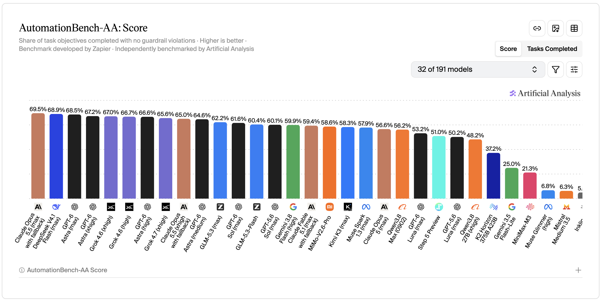
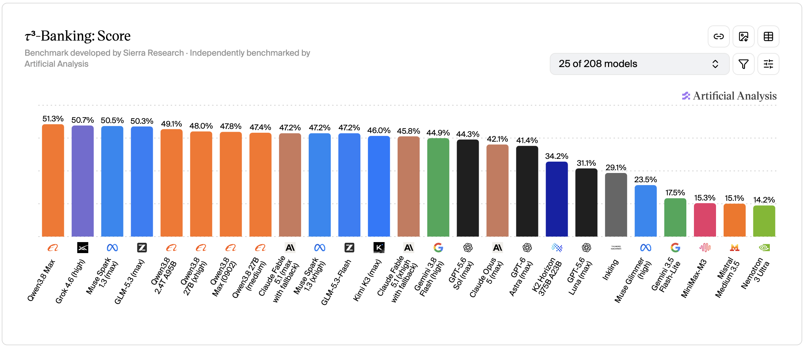

# EnterpriseRL: Real-World Enterprise Agent Tasks

We present EnterpriseRL, a suite of reinforcement-learning environments for end-to-end, real-world enterprise operations. Each environment models one company's operation in full — its policy library, its customer records and the tools that act on them — and each task puts an agent in front of a customer who brings nothing but a goal. To resolve it, the agent must find the policy that governs the case, reconstruct the customer's true state, and carry the case through to a verifiable outcome under the organization's real constraints. Every task is graded deterministically on the final state of the company's database, making EnterpriseRL a foundation for both training and evaluating autonomous enterprise agents.

## Design Philosophy

### 1. Grounded in real, high-frequency, high-value customer service

We partner with senior operations and customer-service leaders to build 150+ B2B and B2C enterprise environments — online travel platforms, supermarket franchise chains, health insurers, banks, national gym chains and beyond. Real company policies and real customer demand are our reference; each environment is then redesigned from that reference as a fictional company, with its own brand, policy library, customers and records. It keeps the structure and difficulty of real operations while carrying no real customer data and no proprietary policy text. Both the partnerships and the coverage continue to expand.

### 2. The real challenge of enterprise agents

Benchmarks such as AutomationBench-AA, Tau3-banking-AA and EnterpriseOps-Gym-AA have become the standard way to evaluate enterprise agents, and for good reason: they grade deterministic end states in realistic business systems. Yet the task still arrives fully specified — the policy in the system prompt, the tools in `selected_tools`, the user's request itemized into entities, amounts, dates and sub-steps. What they measure is instruction following.

Enterprise work runs the other way. The user brings a goal and nothing else. The agent must explore a vast policy library for the rule that actually governs the case, reconstruct the user's true state across accounts and ledgers, and judge the path to resolution — returning to the user whenever a decision is theirs to make.

Our tasks restore exactly that reality: a goal-only request, a vast policy library to explore and exploit, an account state to reconstruct, and a customer who answers only what is asked.

The unit of design is the **environment**: one company's complete customer-service operation. On average, an environment couples 6.7 interlocking product lines and ships 362.2 policy documents, 27.0 tools available to the agent from the outset, and 28.9 further tools it must discover in the policy library and unlock — 10.3 of which only the customer may execute. Each environment carries 8.3 curated tasks on average, every one modeled on real customer cases gathered with domain experts.

The defining strength of the EnterpriseRL is its industry breadth combined with a very low ratio of tasks to environments — precisely the diversity RL needs most. Tau3-banking, the prevailing reference, spans a single environment with 97 tasks. We span 150+ environments and counting: each offers far richer context, and each is deliberately held to 8.3 carefully selected tasks on average, so the dataset scales through breadth rather than repetition within a single environment.

### 3. Three difficulty controls for iterative RL and RFT

Difficulty can be tuned along three independent axes, so training can progress from easier to harder configurations across iterations of RL and RFT.

**Task difficulty.** Every task is graded EASY, MEDIUM or HARD by how hard its prerequisites are to uncover and resolve, how many interacting business factors shape the outcome and how intricately they combine, and how complex its environment — database and knowledge base — is.

**Knowledge-base difficulty.** Two settings are available:

1. **Default.** The knowledge base mirrors a real company's policy library, noise included: superseded clauses, and information dispersed across many documents.
2. **Denoised.** The agent is relieved of most of the burden of locating and assembling policy, and concentrates on understanding the customer's situation. Because this departs from real deployment conditions, and realism comes first, it is offered on request only.

**User simulator.** Researchers choose the model that plays the customer; the more capable it is, the easier the task becomes for the agent under test. We use **DeepSeek-V4.1-Flash**, the state-of-the-art open model on [AutomationBench-AA](https://artificialanalysis.ai/evaluations/automationbench-aa), so that the difficulty we observe is the difficulty designed into the tasks, not the agent's burden of coaching a weak customer. A less capable customer, such as GPT-5.4-mini as used in [Tau3-Banking-AA](https://artificialanalysis.ai/methodology/intelligence-benchmarking#tau3-banking), is a common industry choice and makes the tasks harder still. For rejection sampling or RL, we recommend randomizing the customer model across episodes to broaden the range of customer behaviour.

## Experiment

### Test Setting

Each task is one live customer-service conversation between two models: the **agent** under test and a **customer** played by a user simulator. They share an environment holding the company's database, knowledge base and tools. The clock is frozen at a fixed "now", and the task is scored by the final state of the database.

#### The environment

| Component | What it holds | Task file |
|---|---|---|
| Database | The company's full records — customers, accounts, holdings and the complete history behind them — across all its product lines | `environment/db.json` |
| Knowledge base | The company's policy library: policies, procedures, eligibility conditions and the names of specialized tools. As in a real company, some clauses are superseded and a single rule is often spread across several documents | `environment/knowledge_base/` |
| Share tools | Always listed to their owner: record lookups, identity verification, transfer to a human | `environment/share_tools.py` |
| Discoverable tools | The operations that change a customer's account, across every product line. Listed nowhere; their names appear only in the knowledge base. Each belongs to the agent or to the customer | `environment/task_tools.py` |

#### The roles

| | Agent (model under test) | Customer (user simulator) |
|---|---|---|
| System prompt | `instruction.md`: company background, the current date and time, operating guidelines. No business rule or specialized tool name | `user_simulator.md`: role-play rules and a private brief — the goal, identifying details, and facts to reveal only when asked |
| Access | The knowledge base and the database, through its tools | The conversation only |
| Tools | `KB_search` and `grep` over the knowledge base, its share tools, `unlock_agent_discoverable_tool`, `call_agent_discoverable_tool`, `unlock_user_discoverable_tool` | `call_user_discoverable_tool` |
| Scope | Finds the governing policy, reconstructs the customer's state from the records, decides the resolution, and performs the company's actions | Performs only the actions reserved for the customer, once the agent hands over the tool |

#### Discovering and unlocking tools

1. The agent finds the name of the tool it needs in the knowledge base.
2. An agent-owned tool is unlocked with `unlock_agent_discoverable_tool`, which reveals its parameters, and run with `call_agent_discoverable_tool`.
3. A customer-owned tool is handed over with `unlock_user_discoverable_tool`; the agent tells the customer the tool name and argument values, and the customer runs it with `call_user_discoverable_tool`.
4. Tools only execute. Every judgement, and every argument value passed to a tool, is the agent's to derive from the knowledge base and the records.

#### The conversation

- The agent greets first, then the two sides take turns; each turn is either a message or a tool call.
- The agent must verify the caller's identity before reading or changing the account.
- The customer states its goal and reveals the rest of its brief step by step, some facts only when asked.
- The customer ends the call with `###STOP###` once its requests are handled or declined under policy, or `###TRANSFER###` after a hand-off to a human.

#### Scoring

The verifier replays every recorded tool call on a fresh copy of the database, does the same with the reference actions, and compares the two resulting databases. The reward is **1** only when they match **and** the customer ended the call normally; otherwise it is **0**, with no partial credit. A missing action, a wrong argument or an unwarranted change all score 0.

### Model Performance

All results are measured on a private held-out set of tasks.

#### Hyperparameters

| Parameter | Value |
|---|---|
| Customer model | DeepSeek-V4.1-Flash, medium reasoning effort |
| Temperature | 1.0 for both models |
| Max output tokens per model call | 65,536 |
| Max turns per conversation | 200 |
| Max tool errors per conversation | 10 |
| Time limit per conversation | 3,600 s |
| Knowledge base | Default |
| Attempts per task | 8 |

pass@k is the unbiased estimate, from the 8 attempts, of the probability that at least one of k attempts succeeds, averaged over tasks. Every conversation ended normally; none reached the turn or error limit.

#### Overall

pass@k in %; Avg Steps is the mean number of turns per conversation, counting both the agent and the customer.

| Model | pass@1 | pass@4 | pass@8 | Avg Steps |
|---|---|---|---|---|
| DeepSeek-V4.1-Flash (Max Effort) | 15.6 | 41.2 | 55.0 | 37.9 |
| Kimi-K3 (Max Effort) | 11.9 | 33.4 | 50.0 | 29.7 |
| GLM-5.3 (Max Effort) | 5.6 | 18.6 | 30.0 | 27.9 |
| GPT-6-Astra (Max Effort) | **59.4** | **89.0** | **95.0** | 29.6 |

#### By difficulty

pass@k in %; Avg Steps is the mean number of turns per conversation, counting both the agent and the customer.

**EASY**

| Model | pass@1 | pass@4 | pass@8 | Avg Steps |
|---|---|---|---|---|
| DeepSeek-V4.1-Flash (Max Effort) | 27.5 | 65.1 | 80.0 | 35.3 |
| Kimi-K3 (Max Effort) | 10.0 | 40.0 | 80.0 | 28.4 |
| GLM-5.3 (Max Effort) | 7.8 | 24.1 | 37.5 | 26.0 |
| GPT-6-Astra (Max Effort) | **60.0** | **89.4** | **100.0** | 26.7 |

**MEDIUM**

| Model | pass@1 | pass@4 | pass@8 | Avg Steps |
|---|---|---|---|---|
| DeepSeek-V4.1-Flash (Max Effort) | 12.5 | 35.7 | 42.9 | 36.3 |
| Kimi-K3 (Max Effort) | 16.1 | 41.6 | 57.1 | 27.5 |
| GLM-5.3 (Max Effort) | 5.4 | 18.4 | 28.6 | 26.9 |
| GPT-6-Astra (Max Effort) | **53.6** | **91.6** | **100.0** | 29.6 |

**HARD**

| Model | pass@1 | pass@4 | pass@8 | Avg Steps |
|---|---|---|---|---|
| DeepSeek-V4.1-Flash (Max Effort) | 10.9 | 31.1 | 50.0 | 41.1 |
| Kimi-K3 (Max Effort) | 9.4 | 22.1 | 25.0 | 32.6 |
| GLM-5.3 (Max Effort) | 2.5 | 10.0 | 20.0 | 29.8 |
| GPT-6-Astra (Max Effort) | **64.1** | **86.4** | **87.5** | 31.3 |

## Result Analysis

### 1. Domain matters

Across telecom, banking, airline and similar industries, models pass markedly more often. Operations experts in these industries tell us their company policies are usually kept tightly closed, so pretraining should give models no more exposure to them than to any other industry. The most likely explanation is that these domains are covered by dedicated public benchmarks and have received focused attention as a result — and that advantage carries over to our tasks.

Pooled over all four models, in %:

| Domain | pass@1 | pass@4 | pass@8 |
|---|---|---|---|
| Benchmark-heavy domains (`national_network_airline`, `consumer_electronics_retailer`, `peer_to_peer_payments_app`, etc.) | **30.3** | **58.8** | **72.5** |
| Long-tail domains (`workplace_dining_and_catering_provider`, `ski_resort_operator`, `farm_supply_and_grain_cooperative`, etc.) | 15.9 | 32.4 | 42.5 |

- The gap holds for every model: each one scores higher in benchmark-heavy domains, from 1.4× (GPT-6-Astra) to 8× (GLM-5.3) in pass@1.
- It holds even though the benchmark-heavy tasks skew harder by difficulty label.

### 2. Public leaderboards overstate benchmark-tuned models, and real work exposes them

On the two public benchmarks closest to our setting, GPT-6-Astra is not the leader. On AutomationBench-AA, DeepSeek-V4.1-Flash edges it out; on Tau3-Banking-AA, both GLM-5.3 and Kimi-K3 score above it. On our tasks the order collapses: GPT-6-Astra's pass@1 is 3.8× that of DeepSeek-V4.1-Flash, 5.0× that of Kimi-K3 and 10.6× that of GLM-5.3.

| Model | AutomationBench-AA | Tau3-Banking-AA | EnterpriseRL pass@1 |
|---|---|---|---|
| GPT-6-Astra (Max Effort) | 68.5 | 41.4 | **59.4** |
| DeepSeek-V4.1-Flash (Max Effort) | **68.9** | — | 15.6 |
| Kimi-K3 (Max Effort) | 58.3 | 46.0 | 11.9 |
| GLM-5.3 (Max Effort) | 62.2 | **50.3** | 5.6 |

Public scores from Artificial Analysis ([AutomationBench-AA](https://artificialanalysis.ai/evaluations/automationbench-aa), [Tau3-Banking-AA](https://artificialanalysis.ai/methodology/intelligence-benchmarking#tau3-banking)), in %; "—" means not listed.

[](figs/AutomationBench-AA.png)

[](figs/Tau3-Banking-AA.png)

We draw two conclusions.

- **Leaderboard gains do not generalize.** A model can climb a public benchmark by fitting its distribution — its policy style, tool conventions and task templates — rather than by acquiring the underlying capability. Once the policy must be discovered, the account state reconstructed and the resolution judged from a goal alone, those gains vanish. Public leaderboard positions are an unreliable signal for enterprise deployment; a private, realistic, out-of-distribution evaluation such as ours is what tells the two apart.
- **The frontier's lead is wider than it looks.** Public benchmarks understate how far the closed frontier model is ahead of the strongest open models, and the gap lies precisely in the out-of-distribution competence that enterprise work demands. That is also where diverse, realistic training environments beyond the benchmark-heavy domains have the most to offer.

## Sample Package

This package contains two tasks — one HARD, one MEDIUM — the harness that runs them, and a rollout of each task by every model above.

```
.
├── README.md
├── harbor_tasks/                 the tasks, in Harbor format; see harbor_tasks/README.md to run them
│   ├── env_0013_workplace_dining_and_catering_provider__micro_market_desk__0__4b07c1e9          HARD
│   └── env_0020_national_network_airline__ticket_changes_refunds_and_disruptions__0__2b946ad3   MEDIUM
├── harbor_erl_agent/             the harness: plays the conversation between the agent and the customer
└── jobs/                         one rollout per task and model
    ├── DeepSeek-V4.1-Flash (Max Effort)/
    ├── GLM-5.3 (Max Effort)/
    ├── GPT-6-Astra (Max Effort)/
    └── Kimi-K3 (Max Effort)/
```

**A task** (`harbor_tasks/<task>/`) is self-contained:

| Path | Contents |
|---|---|
| `instruction.md` | The agent's system prompt |
| `user_simulator.md` | The customer's system prompt, with its private brief |
| `task.toml` | Task metadata and difficulty label |
| `environment/` | The company's database, knowledge base and tools, with the runtime that serves them |
| `tests/` | The verifier and the expected final database |
| `solution/` | The reference solution |

**A rollout** (`jobs/<model>/<task>/`) was drawn at random from the model's eight attempts on that task:

| Path | Contents |
|---|---|
| `agent/transcript.json` | The full conversation, with every tool call and its result |
| `agent/` | Each side's trajectory and every model call |
| `verifier/` | The reward and the scoring details |
| `artifacts/` | The recorded tool calls and the final database |
